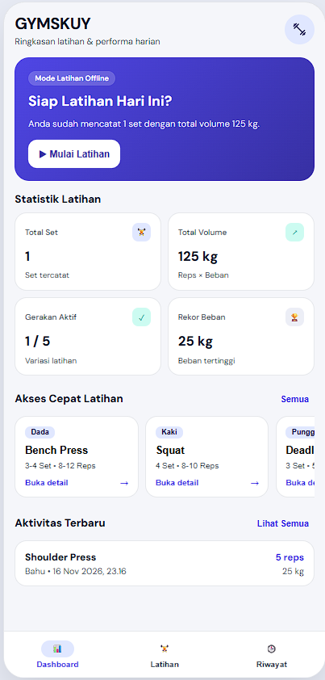
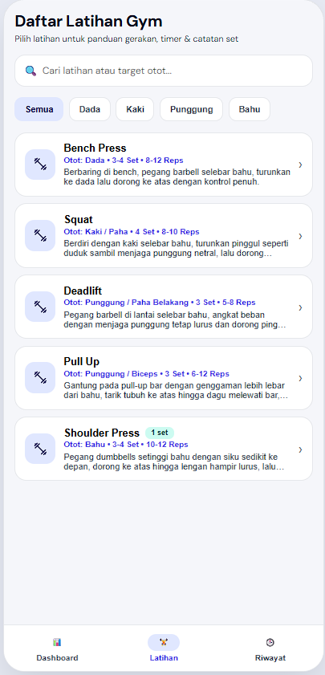
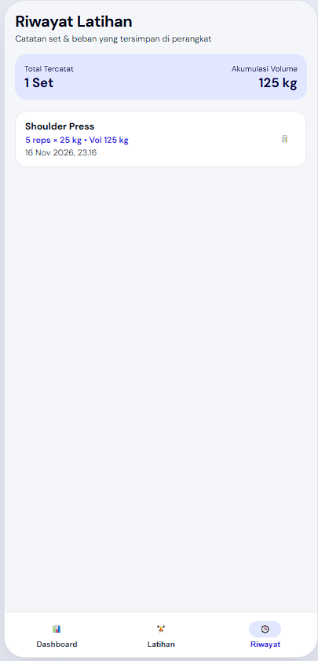

# Pengumpulan UTS Pemrograman Mobile — 2305101024-MUHAMMADDAFFAFEBRIANO-GYMSKUY

## Identitas Mahasiswa

- Nama: MUHAMMADDAFFAFEBRIANO
- NIM: 2305101024
- Kelas: 7B
- Program Studi: Teknik Informatika
- Mata Kuliah: Pemrograman Mobile
- Tahun Akademik: 2026/2027

## Deskripsi

Repository ini berisi source code, dokumentasi, dan hasil implementasi aplikasi mobile **GYMSKUY (AplikasiGym)** untuk pengerjaan Ujian Tengah Semester (UTS) mata kuliah Pemrograman Mobile.

## Deskripsi Pengerjaan UTS

Aplikasi mobile **GYMSKUY (AplikasiGym)** adalah aplikasi panduan dan pencatat latihan gym offline berbasis Android. Aplikasi ini membantu pengguna memantau statistik latihan melalui halaman Dashboard, mencari daftar gerakan latihan berdasarkan nama maupun kelompok otot target, membaca panduan cara melakukan gerakan, menggunakan timer istirahat interaktif, serta mencatat dan mengelola riwayat set latihan (jumlah repetisi dan beban dalam kilogram) secara lokal menggunakan Room Database.

## Teknologi yang Digunakan

- Bahasa Pemrograman: Kotlin (2.2.10)
- Framework: Android Jetpack Compose (Material 3, Navigation Compose 2.8.9)
- Tools: Android Studio, Gradle 9.3.1 (Kotlin DSL), Android Gradle Plugin 9.1.1, KSP 2.3.5
- Database: Room Persistence Library (2.7.0) dengan penyimpanan SQLite lokal

## Fitur yang Diimplementasikan

1. **Dashboard Ringkasan Latihan (`DashboardScreen`)**: Menampilkan statistik langsung dari database lokal (Total Set, Total Volume dalam kg, Gerakan Aktif, dan Rekor Beban), akses cepat latihan populer, serta daftar aktivitas terbaru.
2. **Daftar Latihan Gym, Pencarian, dan Filter Otot (`HomeScreen`)**: Menampilkan daftar gerakan offline (*Bench Press*, *Squat*, *Deadlift*, *Pull Up*, *Shoulder Press*) lengkap dengan fitur pencarian real-time (`Cari latihan...`) dan filter chip berdasarkan kelompok otot (*Semua*, *Dada*, *Kaki*, *Punggung*, *Bahu*).
3. **Detail Latihan dan Panduan Gerakan (`DetailScreen`)**: Menampilkan target otot, target set/repetisi, serta panduan langkah cara melakukan gerakan.
4. **Timer Istirahat Interaktif**: Dilengkapi progress ring melingkar, pilihan durasi cepat (30, 60, dan 90 detik), serta tombol kontrol *Mulai*, *Jeda*, dan *Reset*.
5. **Pencatatan Set dan Riwayat Latihan (`HistoryScreen`, `ExerciseDatabase`)**: Formulir untuk menyimpan jumlah repetisi dan beban (kg) ke Room Database (`exercise_records`), lengkap dengan halaman riwayat seluruh latihan dan fitur hapus catatan.

## Struktur Folder

Struktur direktori proyek Android dan acuan pengumpulan UTS:

- `app/`: Source code utama aplikasi Android (`MainActivity.kt`, `DashboardScreen.kt`, `HomeScreen.kt`, `DetailScreen.kt`, `HistoryScreen.kt`, `Exercise.kt`, `ExerciseRecord.kt`, `ExerciseDao.kt`, `ExerciseDatabase.kt`, tema Material 3, dan resources).
- `gradle/`: Konfigurasi Gradle dan Version Catalog (`libs.versions.toml`).
- `build.gradle.kts` & `settings.gradle.kts`: Konfigurasi build proyek tingkat root.
- `uts/screenshots/`: Lokasi penyimpanan bukti visual hasil implementasi aplikasi (seperti `halaman-utama.png`, `halaman-kedua.png`, dan `hasil-implementasi.png`).
- `README.md`: Dokumentasi lengkap proyek dan identitas pengumpulan UTS.

## Persyaratan Menjalankan Aplikasi

- Android Studio (versi terbaru yang mendukung AGP 9.1.1 dan Kotlin 2.2.10)
- Java Development Kit (JDK) 11 atau JDK 21
- Android SDK 36 (Minimum SDK 24 / Android 7.0 Nougat)
- Gradle 9.3.1
- Perangkat Android fisik (dengan USB Debugging aktif) atau Android Emulator

## Cara Menjalankan Aplikasi

1. Clone atau unduh repository dari GitHub:
   ```bash
   git clone https://github.com/Gatottzy/2305101024-MUHAMMADDAFFAFEBRIANO-GYMSKUY.git
   ```
2. Buka folder proyek menggunakan **Android Studio**.
3. Tunggu hingga proses **Gradle Sync** selesai mengunduh seluruh dependensi.
4. Pilih perangkat tujuan (Android Emulator atau HP Android yang terhubung melalui USB).
5. Klik tombol **Run** pada Android Studio atau jalankan perintah berikut melalui terminal di direktori root proyek:
   ```bash
   ./gradlew assembleDebug
   ```
6. Untuk menjalankan unit test:
   ```bash
   ./gradlew testDebugUnitTest
   ```

## Screenshot Hasil Implementasi

Dokumentasi tampilan aplikasi disimpan pada folder `uts/screenshots/`:

### 1. Halaman Utama (Dashboard)


### 2. Halaman Kedua (Daftar Latihan Gym)


### 3. Hasil Implementasi (Riwayat Latihan)


## File APK

File APK hasil build debug tersedia pada lokasi berikut setelah proses kompilasi:

- Lokasi lokal: `app/build/outputs/apk/debug/app-debug.apk`
- Tautan unduhan eksternal (jika diunggah ke penyimpanan cloud): `[Tambahkan tautan Google Drive / GitHub Releases jika diperlukan]`

## Referensi

- Dokumentasi Resmi Android Developers - Jetpack Compose: https://developer.android.com/compose
- Dokumentasi Resmi Material Design 3 untuk Compose: https://developer.android.com/develop/ui/compose/designsystems/material3
- Dokumentasi Resmi Android Room Persistence Library: https://developer.android.com/training/data-storage/room
- Dokumentasi Resmi Navigation with Compose: https://developer.android.com/develop/ui/compose/navigation
